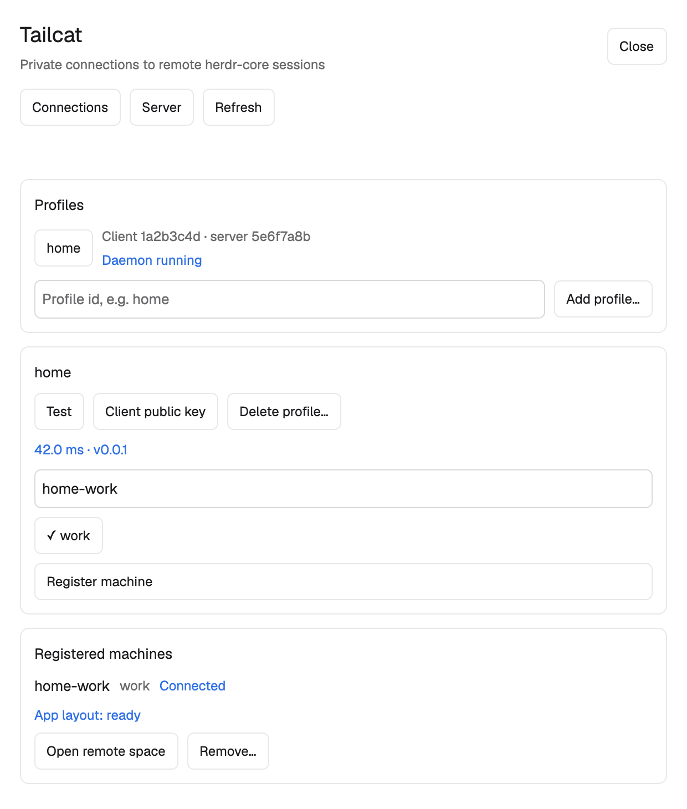

# herdr-tailcat

A Tailcat transport and Herdr App mod for connecting a local herdr-core to a remote Unix computer.

The preview uses mock data in a separate scratch App window. Its body is expanded to show the controls; the installed dialog is 620 × 640 with scrolling.

~~~mermaid
flowchart LR
  App[Herdr App] --> Local[Local herdr-core]
  Local --> via[via: one per connection]
  via --> daemon[Profile daemon]
  daemon --> Tailcat[Tailcat: direct or DERP]
  Tailcat --> serve[serve]
  serve --> Remote[Remote herdr-core]
~~~

The local core starts via as a stdio transport. A per-profile daemon shares a persistent Tailcat identity across connections. The remote serve process validates the requested session and starts only herdr-core connect for that session. Closing the panel does not stop these processes or remote terminals.

## Install the CLI

Install herdr-core on both computers and Herdr App on the client. Put hc on PATH. Install the same herdr-tailcat release on both computers:

~~~sh
go install github.com/zhdsmy/herdr-tailcat/cmd/herdr-tailcat@v0.0.4
~~~

With a checkout and Go 1.27 or newer:

~~~sh
mkdir -p "$HOME/.local/bin"
go build -trimpath -ldflags '-X github.com/zhdsmy/herdr-tailcat/internal/version.Build=v0.0.4' -o "$HOME/.local/bin/herdr-tailcat" ./cmd/herdr-tailcat
~~~

Add the installation directory to PATH. On macOS, keep both installed executables outside Documents, Desktop and Downloads, including symlink targets. Tailscale reads its executable during startup; protected folders can trigger a privacy prompt and stall launchd. Service generation rejects such locations.

## Set up the remote server

Run these on the computer whose terminals you want to access:

~~~sh
herdr-tailcat server init
herdr-tailcat server export add default
~~~

Export default to see the everyday terminals in the ordinary core session. A different session, such as work, is an independent core session. Repeat export add for each session you intend to expose. Use the same Unix account and XDG environment as the remote core. Do not run serve as root merely to reach another user's terminals.

Run the following privately and transfer its output to your client through a secure channel:

~~~sh
herdr-tailcat server show-address --full
~~~

Treat the address as a password. The only address placeholder used in this guide is <address from server show-address --full>; never put an actual address in command arguments, environment variables, issue reports or screenshots.

## Set up the client

Import the address interactively with hidden input:

~~~sh
herdr-tailcat profile add home --prompt
herdr-tailcat profile pubkey home
~~~

On the remote server, allow that client public key, then start serve:

~~~sh
herdr-tailcat server allow add '<client-public-key>'
herdr-tailcat serve
~~~

The public key is the nodekey value printed by profile pubkey. There must be at least one allowed client. After changing exports or allowed clients, restart serve; server status reports restart_required.

Back on the client:

~~~sh
herdr-tailcat profile test home
herdr-tailcat profile register home --name home-work --session default
~~~

The local core now maintains the remote machine. To remove just this registration:

~~~sh
herdr-tailcat profile unregister home --name home-work
~~~

Profile deletion refuses an in-use profile unless --force is explicit. Management commands that invoke hc (including profile ls) automatically start the selected local core if it is absent. Scripts must select their intended HC_SESSION and XDG directories.

For a macOS server service, first install executables in their final paths, then run these on the server:

~~~sh
herdr-tailcat server install-service
herdr-tailcat server service start
herdr-tailcat server service status
~~~

Generation and loading are separate. Linux service generation prints a systemd user unit; loading it is manual. See [services](docs/services.md) for configuration and shutdown behavior.

## Install the App mod

The mod runs local programs and reaches the network through herdr-tailcat and Tailcat/DERP. It reads CLI-managed state through the JSON interface, rather than opening profile or key files itself.

1. Read [RECIPE.md](RECIPE.md) and the four files in mods/tailcat.
2. Copy mods/tailcat into ~/.config/herdr-app/mods/tailcat. If that name already exists, rename the new mod and update its internal mods/tailcat paths before installing; do not overwrite another mod.
3. Run herdr-app check ~/.config/herdr-app/mods/tailcat.
4. Open it with herdr-app do mod.open --name tailcat. The optional [keys.json](keys.json) snippet binds cmd-shift-t; merge it into your own global section and ask before replacing any existing binding.

The package contains no layouts folder and does not replace the current layout. Connections lets you import a profile, Test, choose an exported session, Register, Open remote space and Remove with an inline confirmation card. The Server page manages an already initialized local server. A client-only installation does not need server state.

## Security and limits

- Tailcat encrypts the transport. The server address contains a PSK; each client also needs an explicitly allowed public key. The whitelist is validated before startup and an empty whitelist fails closed.
- Only TCP port 6470 has an application handler. Requests use a bounded prelude and an explicit export list. This transport offers no arbitrary remote command handler. Authorized Herdr clients still have normal terminal access to the exported core sessions.
- Private state defaults to ~/.local/state/herdr-tailcat, with private directories and files. HERDR_TAILCAT_HOME overrides it. Registrations from a non-default directory bind its normalized path explicitly; default-directory targets retain the legacy format. See [target ownership and legacy registrations](docs/cli-json.md#commands) before re-registering older non-default targets. Do not share that directory.
- A new successful stream from the same client key to the same session replaces the old stream. When max_conns is full, a client that already holds a stream may still finish that replacement: at most four such handshakes are in flight, and a handshake that does not replace an existing stream is rejected. Other clients still receive server busy. A duplicate registration can briefly displace an existing line. Client-to-server inactivity closes a stream after 90 seconds. Steady state never keeps more streams than max_conns.
- A server crash can take about 45–70 seconds to detect and recover with core's default timing. Planned shutdown drains TCP; it does not end remote terminal programs. Restarting a core itself follows core's terminal lifecycle semantics.
- CLI attach viewers exit when their local core connection ends; reopen them after a local core restart. The transport does not add viewer reconnection.
- Address reveal is explicit and disappears after 30 seconds or when closed. Copy is manual; the system clipboard is not automatically cleared.

## Compatibility and checks

Validated on macOS with herdr-core 0.1.16–0.1.17 and Herdr App 0.1.12. Tailcat is pinned to v0.7.0. Linux cross-compiles and has platform unit coverage; Linux runtime behavior has not been tested. Windows is unsupported.

Offline/unit checks (dependencies must already be cached to work offline):

~~~sh
go mod verify
test -z "$(gofmt -l cmd internal)"
go test ./...
go vet ./...
go test -race ./...
GOOS=linux GOARCH=amd64 go build -o /tmp/herdr-tailcat-linux ./cmd/herdr-tailcat
node --test tests/panel.test.mjs
node --experimental-loader ./tests/app-loader.mjs --test tests/panel-app.test.mjs
PYTHONDONTWRITEBYTECODE=1 python3 -m unittest discover -s scripts -p 'test_*.py'
python3 scripts/app-check.py
~~~

For optional macOS runtime checks, build bin/herdr-tailcat as a copy source first. The runners copy it and hc into scratch bin directories before execution. They use tc-* sessions, private XDG directories and HERDR_TAILCAT_HOME, random test launchd labels, ownership checks before signals, and cleanup. They inspect process/socket metadata and read-only default-core status to guard existing processes; they do not read real profiles or keys. These tests require hc, network access, launchd and an otherwise stable real App/core baseline. A failed ownership proof prevents signaling. Treat reported cleanup errors as failures.

~~~sh
go build -trimpath -o bin/herdr-tailcat ./cmd/herdr-tailcat
LC_ALL=C python3 scripts/fault-matrix.py --only K1,K2a,K4,K4b,K7,L1
python3 scripts/cli-e2e.py
python3 scripts/prompt-e2e.py
~~~

The --only subset above is a quicker check: kill a via process (K1), crash the client core (K2a), crash and restart serve (K4, K4b), restart the client core (K7) and run serve under launchd (L1). Omit --only for the full matrix, which adds a 5-minute stability run and 20 cold dials. Case IDs are listed in the docstring of scripts/fault-matrix.py and in `--help`.

Native mod checks use a private HERDR_APP_HOME and never open or install into a real App window. Some App versions generate ignored type stubs next to the checked mod.

See [the mod brief](RECIPE.md), [JSON contract](docs/cli-json.md), [panel behavior](docs/panel.md), [services](docs/services.md) and [Tailcat API notes](docs/tailcat-api-notes.md). The project is [MIT licensed](LICENSE); dependency licenses are listed in [THIRD-PARTY-NOTICES.md](THIRD-PARTY-NOTICES.md).
