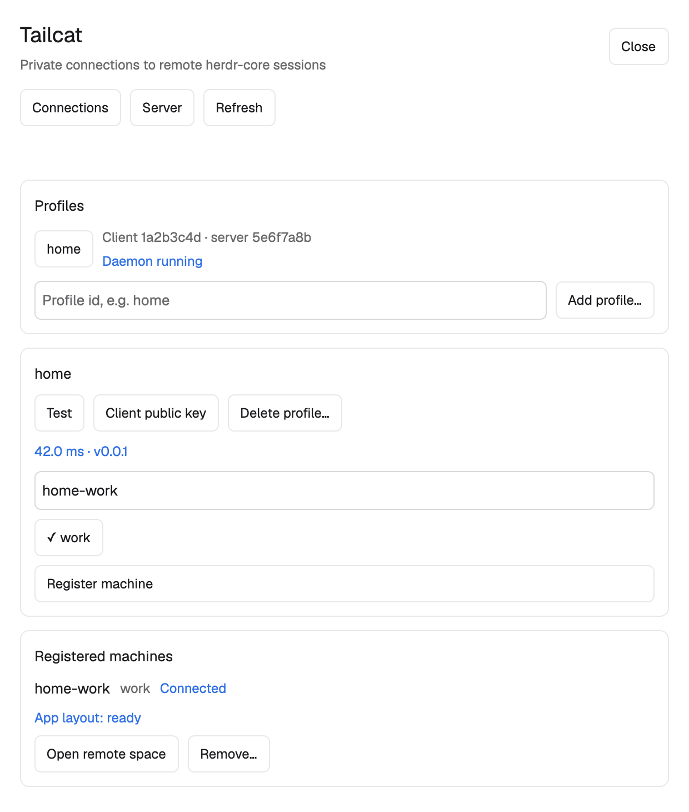

# Tailcat

A dialog in Herdr for connecting to remote herdr-core sessions through Tailcat. Connections shows saved profiles, a test result and exported sessions, then the registered machines with their connection and App-layout state. A second page manages an already initialized local server. The preview uses mock data and expands the scrolling body; the installed dialog stays 620 × 640.

## What you see

The dialog is 620px wide and 640px high, with 18px outer padding, 12px vertical gaps, a surface background and foreground text at 13px. The first row has the 19px semibold Tailcat title, a 12px muted subtitle and Close. The next row has Connections, Server and Refresh. A fixed 24px feedback row reserves space for progress, success, errors and queued-command count, and scrolls long messages within that row. An inline confirmation card, when needed, sits below it and above the flexible scrolling page body.

Cards have 12px padding, 8px gaps, an 8px radius, a 1px border and the background color. Buttons have 10px horizontal and 6px vertical padding, a 6px radius, a 1px border and 12px text. Notes use 12px. Use the current theme's surface, background, foreground, border, muted, dim, input and hover tokens. Working operations use working, successful tests and connected states use done, errors and destructive confirmations use blocked, and an offline machine with no reason uses idle. No colors are hardcoded.

Connections contains three cards, top to bottom:

- Profiles: a button per profile, client/server eight-character fingerprints and Daemon running or Daemon idle; a profile-id input and Add profile… button. Empty state explains hidden-input import.
- Selected profile: its name, Test, Client public key and Delete profile…; after Test, a one-decimal millisecond RTT and server version, a machine-name input, one button per exported session with a check on the selected session, and Register machine. Requested public keys appear here with allowlist instructions.
- Registered machines: only registrations belonging to these profiles, each with name, session, connection state, App layout state, optional reason, Open remote space and Remove… buttons. The empty state explains how to register.

Server shows deployment instructions if uninitialized. Otherwise it has a server status card (running/stopped, stream and client counts, version, configuration-restart warning, Show address and macOS service controls), an exported-sessions card, and an allowed-clients card with fingerprints. Address reveal uses a separate 580px dialog with the address, Copy address and Hide. Its heading says it clears after 30 seconds, with a trusted-client warning.

## How it behaves

Close dismisses the panel. Connections and Server switch pages; Server loads local server status and allowed clients only when selected. Refresh explicitly reloads the current page and reports progress. Every five seconds, refresh quietly only while App is active, the panel is open, and no operation, refresh, queued command or confirmation is pending. Preserve feedback and enabled controls during quiet polling; do not redraw unchanged data. A failed poll adds Last refresh failed.

Selecting a profile fills the machine name with that id plus -tailcat; a retained successful Test selects its first export. Add profile… collects only a valid id, opens a dedicated terminal with hidden address input, and allows polling or manual refresh to discover the import. A later refresh recognizes the imported id and shows its public key. If terminal creation fails, display external-terminal instructions. Test measures RTT and lists exported sessions. Selecting a session changes its check mark. Register machine uses the selected session and name; it is disabled until Test and session selection succeed. It registers through the CLI and reloads profiles; quiet polling then tracks connection state.

Client public key displays the public key and server allowlist instructions. Delete profile… shows an inline confirmation card; if registered machines exist, its warning explains force removal and daemon shutdown. Remove… similarly requests confirmation for one machine. Confirm or Enter performs only the pending action; Cancel or Escape dismisses it without mutation and leaves the panel open. Disable other operation controls during a pending confirmation. Escape with no pending confirmation closes the panel.

Connected uses done. Connecting and reconnecting both read Connecting in working. A failure reason produces Disconnected in blocked, with the reason below; no connection and no reason produces Offline in idle. Display App layout independently. Open remote space is enabled only when connected. It waits at most 20 seconds for ready layout, selects an existing space for that machine or creates one, then waits at most 10 seconds for the space to appear. Keep the panel open so success or errors stay visible.

Serialize operations. Scripted actions enter a FIFO queue of at most 16 entries; wait for the first successful profile load and for busy work to finish. Confirm/cancel may pass queued ordinary work to resolve the confirmation gate. Reject an invalid, foreign or overflowing command visibly. After an initial load failure, Refresh retries while commands remain queued. A 30-second operation deadline shows an error; the CLI has a 24.5-second management budget. Closing cancels waits and queued work, while transports and remote terminals continue.

Server Add session and Remove edit exports. Allow client and Remove edit the whitelist. Configuration changes require a serve restart; show restart_required and last-client warnings. Start service and Stop service control an already generated macOS service, never install one. Show address for 30 seconds… explicitly reveals the secret in a private overlay, clearing it on close or after 30 seconds. Copy writes it only after a click; it does not clear the clipboard later. Address polling is forbidden.

Optional cmd-shift-t opens the mod. Merge the supplied global key snippet; ask before replacing an existing binding. Buttons hover with the theme hover background and expose their visible labels to accessibility.

A shown panel accepts these commands through herdr-app do, prefixed with tailcat.:

~~~text
test:<profile>
pubkey:<profile>
register:<profile>:<session>:<name>
open:<profile>:<name>
unregister:<profile>:<name>
rm:<profile>[:force]
add:<profile>
refresh
page:connect
page:server
confirm
cancel
~~~

## Built from

Ship mods/tailcat/main.js, model.js, client.js and mod.json, plus the optional root keys.json snippet. There is no layouts folder. mod.json sets place:none, title:Tailcat and a dialog overlay width of 620. main.js renders the dialog with View/div and gpui-base v_flex, h_flex, Input and InputState. model.js validates and projects the CLI contract, sanitizes diagnostic text, matches registrations and defines status/deployment text. client.js resolves herdr-tailcat on PATH or ~/.local/bin, calls exec with structured arguments and parses JSON, retrying only a program-start failure.

The root is a vertical flex with header, page controls, fixed feedback, optional inline confirmation and flexible scrolling cards. The address dialog uses the same mod with props.part set to address. The import terminal uses a custom title bar with props.part set to bar and props.id set to the profile id. props.overlay identifies the current overlay. The reveal value lives in a private closure, never props or shared state. No shipped mod, image asset or layout is needed. preview.png is a separate scratch-App mock screenshot, not a runtime asset.

Use herdr exec for CLI calls; hc for the dedicated import terminal; machines for local/remote layout readiness; spaces and run for space.new/space.select; nextCommand for scripted actions; openOverlay/closeOverlay for dialogs and the import terminal; home for the CLI fallback; theme and window for styling, active state and platform. Use fresh callback contexts, focus handles and App timers. Do not retain a context across callbacks.

This mod runs programs through exec and hc and accesses the network through herdr-tailcat via Tailcat direct connections or DERP. Follow docs/cli-json.md exactly. CLI management uses one JSON object, an ok envelope and finite error kinds; show-address is an explicit secret exception. The local core uses --via to launch the CLI's raw via transport, connected over a private Unix socket to a profile daemon and then the remote serve process. Never mix management JSON into that byte stream.

## Watch out

Install the CLI on both computers, the App mod only on the client. Server configuration belongs on the remote computer. Export default to see ordinary everyday home terminals; other sessions have independent terminals. A client needs no initialized server directory. Core versions 0.1.16–0.1.17 and App 0.1.12 were validated on macOS. Linux runtime is untested; Windows is unsupported.

Keep executables outside Documents, Desktop and Downloads on macOS, including symlink targets. Tailscale reads its own executable; a protected path can cause a privacy prompt and hang launchd. Never work around this with signing or permission grants.

A serve crash can take about 45–70 seconds to detect and recover. A successful new stream replaces an old stream with the same client key and session, so a duplicate registration can briefly displace it. Management commands that use hc can start the local core. Gate panel loading on the local core's ready layout. Wait for the remote layout before structural space commands; a null run result alone is not success.

App exec cannot pass stdin. Never put an address in argv or environment; use profile add <id> --prompt in a dedicated TTY terminal. The CLI disables echo/canonical mode, strips bracketed-paste wrappers, restores termios and never writes the address back. The panel must never read the clipboard or use hc send/keys/read for import. The address is a password: do not persist it in panel state, logs, screenshots or shared data.

Do not use window.open_dialog for confirmation: it is invisible inside this dialog overlay. Use the visible inline card and fresh pending action. Explicit height and min_h(0) keep the body from collapsing. A passing herdr-app check does not prove layout, refresh stability or interactive confirmation; check the visible App too. Preserve the 24px feedback slot during quiet polling.

Names follow the core's 1–32-character ASCII rule and exclude terminal-id forms. A profile action must target a loaded profile and an exact matching CLI registration; SSH machines stay outside the panel. Service Start needs a generated plist. Foreground serve, daemon and via have no management JSON stream. Profile deletion with force also removes matching machines and stops its daemon.

## Done when

- A scratch HERDR_APP_HOME native herdr-app check passes for the actual mod and connection/server/error/confirmation/reveal fixtures; logic and View tests pass.
- A nonempty profile list renders fingerprints and daemon state. Test shows RTT, version and exported sessions, and Register is disabled before a valid selection.
- Hidden-input import creates a profile while hc read, attach and stored screen snapshots contain no address fragments.
- Registration reaches Connected, displays App layout separately and remains stable during quiet polling. Register progress and fixed feedback do not make the body jump.
- Remove… visibly shows the inline Confirm/Cancel card. Cancel leaves the registration intact; a second Remove… and Confirm remove only that registration. Enter/Escape work on the same pending action.
- Open remote space waits for ready layout and a visible space; a terminal in that space accepts input and readback from the intended remote computer.
- Closing/reopening or hot reloading the panel retains transports and remote terminal programs. The address overlay clears after 30 seconds and never enters ordinary panel state.
